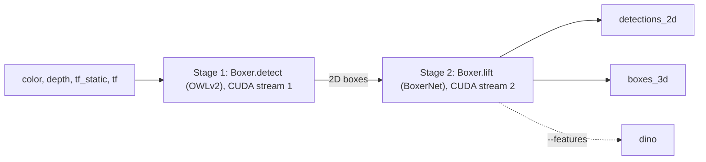

# Design

This page explains how xblick-boxer works inside, which decisions we made, and what we tested with which
result.

## What the node computes per frame

Boxer is a pipeline of two networks.

1. **OWLv2** is an open-vocabulary 2D detector. It finds 2D boxes for the text prompts of `--labels` in the colour
   image.
2. **BoxerNet** lifts each 2D box to an oriented 3D box. It uses three inputs: DINOv3 features of the image, depth
   points, and the direction of gravity.

The depth points are Boxer's *semi-dense points*, which the node samples from the depth image. The node takes the
direction of gravity from the pose of the camera in the world. It assumes that the world's z axis points up.

The node always takes the newest colour frame. It publishes both kinds of boxes with the stamp and the camera
frame of that colour frame.

## Two stages in two threads



Each stage has its own thread and its own CUDA stream. A CUDA stream is a queue of GPU work, and the GPU can
overlap work from two CUDA streams. OWLv2 therefore works on the next frame while BoxerNet lifts the boxes of this
frame. The second stage publishes all results of a frame together. [docs/performance.md](performance.md) states the
effect on the frame rate.

## Decisions

**The node never processes a frame without its parts.** It skips and counts a frame whose pose does not arrive
within `--pose-wait-ms`. It does the same for a frame whose depth is not within `--max-offset-ms`.

**The node fails at start when something is missing.** A missing submodule stops the node with a message that
states what to do. A missing checkpoint is downloaded ("Weights" below), or with `--no-download` it stops the node. `--local cuda` with a camera on the same host that has no CUDA ring is an
error.

**Boxer's code stays unchanged.** Boxer is no Python package. `boxer.py` puts `third_party/boxer` on `sys.path`
and imports from there. All speed changes happen around Boxer's code: the inputs on the GPU and the weights in
bfloat16. After each change we compare the boxes on a test frame with the boxes before it.

**No CPU work between the frame and the model.** The resize and the semi-dense points are computed on the GPU, by
the node's own functions. The resize is bilinear as OpenCV's, without the rounding to uint8.

**A frame without boxes publishes empty arrays.** A viewer can then remove the boxes of the frame before.

**The pose may be fixed or have another stamp than the image.** A fixed camera has its pose on `tf_static`. A robot
often publishes camera poses with its joint state, at their own rate. The node looks the pose up at the stamp of the
image with Durchblick's `poses.TransformBuffer`, which reads both topics and interpolates between two poses on `tf`.

**The licence stays separate.** Boxer's code and checkpoints are CC-BY-NC 4.0. Boxer is a git submodule at a fixed
commit, and the node downloads the checkpoints. This repository contains no copy of either.

## Weights

`weights.py` lists Boxer's three checkpoints: the Hugging Face repository `facebook/boxer` at a fixed commit, each
file's SHA-256 and size. The commit is the one that `main` pointed at on 2026-11-14. Hugging Face states for the files
there the SHA-256 values that the code checks. They go into the node's cache directory, `~/.cache/xblick/boxer/`
(`XBLICK_HOME`, `XDG_CACHE_HOME`, `--weights-dir`). The node and `tools/setup.sh` use this one list. The download
itself is the core's `xblick.weights`.

Boxer's own code reads OWLv2 and DINOv3 from its `ckpts/`, named in module globals. `boxer.use_checkpoints` sets
these globals to the cache directory right after the node imports Boxer, without a change of Boxer's files. BoxerNet's
file is passed explicitly. OWLv2's text-embedding caches then go to the cache directory as well. A test on a GPU
confirmed that Boxer read all three checkpoints there and never created `ckpts/`. The submodule's `ckpts/` is the
checkpoints' former place: the node does not read them there, and it prints the command that moves them.

At its start, before it loads the models, the node checks that every checkpoint exists. When all exist, the node
opens no network connection and writes no file, so it starts offline. When one is missing, the node first checks
that Boxer's source is there, because the node needs its code. Without it, the node ends and names
`tools/setup.sh`. It never clones the submodule. Then the node takes the lock `~/.cache/xblick/boxer/.download.lock`. It prints
Boxer's terms, the files and their size, and it downloads each file. The node writes a file as `<name>.part` and
renames it after the check. A file therefore has its final name only when it is complete. A second node that starts
at the same time waits for the lock. It then finds the files and does not download them again.

The check compares the size and the SHA-256 of each download with those in `weights.py`. A wrong SHA-256 keeps the download as
`<name>.part`, and the error names it. Remove it, then start again. The progress is a line that updates in place on
a terminal. In a log file it is one line per tenth of the file.

A failure ends the node with one line that says what to do. Ctrl-C or SIGTERM during a download end the node at
once with the exit code 130 or 143. The node then removes the `.part` file.

`--download-only` downloads and checks the checkpoints, then ends. It also checks the SHA-256 of checkpoints that
exist. It needs no camera, no Zenoh router and no GPU. `xblick.weights.parse_args` lifts the requirement of `--camera` and
`--labels` when the command line contains `--download-only`. `--no-download` ends the node when a checkpoint is
missing and names it. It is a read-only parameter like every other start option. `--download-only` is a mode of
the command line and has no parameter.

## Tests

```bash
.venv/bin/python -m pytest tests -q
```

Always name `tests`. Plain `pytest` also collects `third_party/boxer` and fails.

| File | Needs | What it checks |
| --- | --- | --- |
| `tests/test_node.py` | no GPU | The conversions: quaternions, `vision_msgs`, depth. The pose of a fixed camera from `tf_static` alone, and a missing pose. |
| `tests/test_weights.py` | no GPU, a local HTTP server | The checkpoints at their pinned commit with their SHA-256, the submodule required first, the node's `STORE`, `--download-only` and `--no-download`, a start that stops after its weights step without a GPU. The download itself: the core's tests. |
| `tests/test_boxer.py` | a GPU and the checkpoints | The semi-dense points from the GPU against Boxer's own, on a synthetic depth image. Two tests need the simulation frame `tests/data/sim_ycb*.png`, which this repository does not contain. They skip. |

## What we measured on the simulation

Setup: a simulation of a table with YCB objects. It publishes the head camera with depth and
`tf`. The node had its own RTX PRO 6000. We put each box into the world with the pose of the camera and compared
its place with the place of the object on the table.

| | 2026-10-28, one stage | 2026-10-29, two stages |
| --- | --- | --- |
| Duration | 40 s | 40 s |
| Camera rate | | 21-23 frames/s |
| Node rate | 11 frames/s | 21-23 frames/s, every camera frame |
| Time per frame | about 88 ms | 65-90 ms from the colour frame to the results |
| Frames skipped | 0 | 0 |
| Messages of each type | 445 | 831 |
| Sugar box, median error | 0.7 cm (443 boxes) | 0.6 cm (830 boxes) |
| Cracker box, median error | 6.2 cm | 2.1 cm |

Notes on the table:

- The first measurement is older than the speed changes in [docs/performance.md](performance.md).
- In the second measurement, the server worked at a real-time factor of 0.7 on a shared GPU. Its camera therefore
  gave only 21-23 frames per second. Other jobs also used the node's GPU.
- OWLv2 named the cracker box "sugar box" in most frames of both measurements.
- In the first measurement, the node did not find the mustard bottle and the soup can. The thresholds were 0.1 and
  0.3. In the still frame of the test, the node found the mustard bottle within 0.6 cm.
- `xblick rerun --save` recorded the 3D boxes, placed with the moving camera, and the 2D boxes in the image.

## Status and limits

- Version 0.1.0, status of 2026-10-29. We tested the node on the simulation. We have not tested it on a robot.
- **Tracking and fusion.** The node does not use Boxer's tracking, which gives ids over frames (`--track` in
  Boxer's `run_boxer.py`). It does not use Boxer's multi-view fusion either.
- **Prompts.** OWLv2 confuses similar objects such as the cracker box and the sugar box. This is a problem of the
  2D detection. The lifting is correct. Better prompts or another 2D detector could help. Boxer's paper also uses
  DETIC and SAM3.
- xblick-boxer was the first vision node on Durchblick. It works in the same way on a robot's camera and on the
  camera of a simulation.
